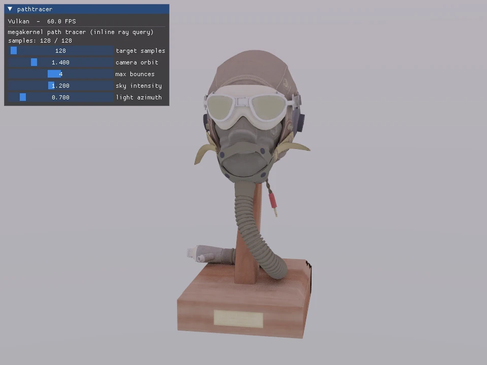
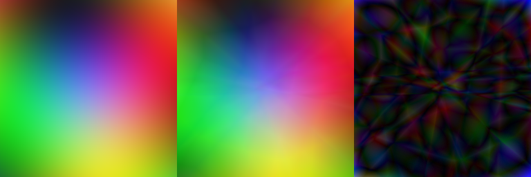

# VRI

[](https://github.com/zzxzzk115/VRI/actions/workflows/ci.yml)

**Try it in your browser:** every web-capable example runs live at
**[zzxzzk115.github.io/VRI](https://zzxzzk115.github.io/VRI/)** — see the
[example gallery](https://zzxzzk115.github.io/VRI/examples/) (WebGPU / WebGL 2).

**VRI** is a cross-platform **Render Hardware Interface**: one explicit, modern rendering API
(command buffers, descriptor sets, explicit synchronization) that runs on many graphics backends
and platforms. Write your renderer once — VRI runs it on Vulkan, Direct3D 12, Metal, WebGPU, and
OpenGL, on desktop, mobile/embedded, and the web.

The explicit API follows [NRI](https://github.com/NVIDIA-RTX/NRI): function tables, opaque handles,
descriptor ranges and timeline fences. It also provides OpenGL/GLES/WebGL paths. VRI is not source- or
ABI-compatible with NRI; see [the NRI user guide](DETAIL.md#for-nri-users) for concrete differences.

## Showcase



Vulkan path tracer rendering the FlightHelmet glTF model at 128 samples and four bounces. The bundled FlightHelmet model is CC0.

To capture the example:

```sh
xmake build -y -j4 example-pathtracer
VRI_MAX_FRAMES=132 VRI_CAPTURE=/tmp/vri-pathtracer.bmp xmake run example-pathtracer
```

The example writes a 960×720 BMP after accumulating the default 128 samples.

## Highlights

- **One API, every backend.** A single explicit, low-level surface (à la Vulkan/D3D12) that maps
  onto each platform's native graphics API.
- **C ABI core + header-only C++23 wrapper.** Use it from C, or from modern C++ with a
  `std::expected`-based RAII layer (`vri/vri.hpp`).
- **Honest capabilities, never silent.** Every optional feature is queryable. If a backend can't do
  something, it tells you — it never silently no-ops.
- **Portable by default.** Quirks that aren't real capability differences (row-pitch alignment,
  integer vertex attributes, coordinate conventions, …) are absorbed by VRI, so the same code
  produces the same image everywhere.
- **One diagnostics sink.** A single message callback receives both VRI's validation messages and
  each backend's native debug output.
- **Built-in validation layer.** Opt-in precondition/lifecycle checks; zero cost when off.
- **Shaders authored in [Slang](https://github.com/shader-slang/slang)**, compiled offline to each
  target's native bytecode.

[Cooperative-vector shader inference](DETAIL.md#cooperative-vector-shader-inference) is optional and Vulkan-only;
query it before compiling or running that path. VRI retains one NRI-style interface. Customizable
device conventions are selected at initialization; neither a Vulkan-style rewrite nor a second API is planned.

## Supported platforms & backends

| Backend | Platforms |
| --- | --- |
| **Vulkan** | Windows, Linux (and macOS via MoltenVK) |
| **Direct3D 12** | Windows |
| **Metal** | macOS (Apple Silicon) |
| **WebGPU** | Windows, Linux, macOS, **Web** |
| **OpenGL** | Windows, Linux (and macOS, capped at 4.1) |
| **WebGL 2** | **Web** |
| **OpenGL ES** | Linux / embedded (e.g. Raspberry Pi) |
| **Software (CPU)** | Windows, Linux, macOS — anywhere with a software Vulkan ICD |

On the web, VRI runs through **two** backends — WebGPU and WebGL 2 — both via Emscripten. The
desktop application requests `Auto` and VRI picks the best backend for the platform.

**Software (CPU) rendering** (`VriGraphicsAPI_Software`) runs the Vulkan backend on a software
Vulkan implementation — no GPU required — so rendering works on headless CI, minimal VMs, and
machines with no usable GPU. It has the full Vulkan feature set at CPU speed, and is the last
`Auto` fallback (only reached when no GPU backend can create a device). It needs a software Vulkan
ICD present: **[SwiftShader](https://github.com/google/swiftshader)** (cross-platform) or **Mesa
lavapipe** (`apt install mesa-vulkan-drivers` — the usual Linux-CI choice). See
[DETAIL.md](DETAIL.md#software-cpu-rendering) for how VRI selects it.

## Feature support

How each feature is supported on each backend:

**✅ Native** &nbsp;·&nbsp; **🟡 Emulated / Simulated** &nbsp;·&nbsp; **⬜ Planned** (the API supports it; not yet in VRI) &nbsp;·&nbsp; **❌ Unsupported by the API**

| Feature | Vulkan | Direct3D 12 | Metal | WebGPU | OpenGL | WebGL 2 | OpenGL ES |
| --- | :---: | :---: | :---: | :---: | :---: | :---: | :---: |
| Core rendering & swapchain | ✅ | ✅ | ✅ | ✅ | ✅ | ✅ | ✅ |
| Depth / stencil, blending, MRT | ✅ | ✅ | ✅ | ✅ | ✅ | ✅ | ✅ |
| MSAA + resolve | ✅ | ✅ | ✅ | ✅ | ✅ | ✅ | ✅ |
| Mipmaps, instancing, cubemaps | ✅ | ✅ | ✅ | ✅ | ✅ | ✅ | ✅ |
| Compute shaders | ✅ | ✅ | ✅ | ✅ | ✅ | ❌ | ❌ |
| Push constants | ✅ | ✅ | ✅ | 🟡 | 🟡 | 🟡 | 🟡 |
| Bindless / descriptor indexing | ✅ | ✅ | 🟡 | 🟡 | 🟡 | 🟡 | 🟡 |
| Geometry shaders | ✅ | ✅ | ❌ | ❌ | ✅ | ❌ | ❌ |
| Tessellation | ✅ | ✅ | ❌ | ❌ | ✅ | ❌ | ❌ |
| Mesh shaders | ✅ | ✅ | ✅ | ❌ | ❌ | ❌ | ❌ |
| Ray tracing | ✅ | ✅ | ✅ | 🟡 | 🟡 | ❌ | ❌ |
| Opacity micromaps | ✅ | ✅ | ❌ | ❌ | ❌ | ❌ | ❌ |
| Variable rate shading | ✅ | ✅ | ❌ | ❌ | ❌ | ❌ | ❌ |
| Conservative rasterization | ✅ | ✅ | ❌ | ❌ | ❌ | ❌ | ❌ |
| Fragment-shader barycentrics | ✅ | ✅ | ⬜ | ❌ | ❌ | ❌ | ❌ |
| Custom sampler border color | ✅ | ✅ | ❌ | ❌ | ❌ | ❌ | ❌ |
| Subgroup / wave operations | ✅ | ✅ | ⬜ | ❌ | ❌ | ❌ | ❌ |
| Multiview (single-pass stereo) | ✅ | ✅ | ✅ | ❌ | ✅ | ❌ | ✅ |
| External memory / interop (CUDA) | ✅ | ✅ | ❌ | ❌ | ❌ | ❌ | ❌ |
| GPU timestamp queries | ✅ | ✅ | ✅ | 🟡 | 🟡 | ❌ | ❌ |
| Occlusion queries | ✅ | ✅ | ✅ | ❌ | ✅ | ❌ | ❌ |
| Pipeline-statistics queries | ✅ | ✅ | ❌ | ❌ | ✅ | ❌ | ❌ |
| Calibrated GPU+CPU timestamps | ✅ | ✅ | ✅ | ❌ | ❌ | ❌ | ❌ |
| Pipeline cache | ✅ | ✅ | ✅ | ❌ | ✅ | ❌ | ❌ |
| Indirect draw count (GPU-driven) | ✅ | ✅ | ❌ | ❌ | ✅ | ❌ | ❌ |
| Video memory budget | ✅ | ✅ | ✅ | ❌ | ❌ | ❌ | ❌ |
| Clear storage buffer / texture | ✅ | ✅ | ❌ | ❌ | ✅ | ❌ | ❌ |
| Built-in Dear ImGui renderer | ✅ | ✅ | ✅ | ✅ | ✅ | ✅ | ✅ |

Per-backend implementation notes — the fallbacks, caveats, and the native extension each feature
uses — are in **[DETAIL.md](DETAIL.md)**. The threading contract (which calls may run concurrently,
and where the caller must synchronize) is in **[docs/threading.md](docs/threading.md)**.

Vulkan enables `VK_NV_shader_subgroup_partitioned` when the device advertises it,
so Slang `WaveMatch` / `WaveMulti*` shaders can use partitioned subgroup operations
without application-side device creation hooks. Devices without this extension
retain their existing core subgroup support.

## Building

VRI uses [xmake](https://xmake.io).

```sh
# configure (enable the backends you want)
xmake f --vri_backend_vulkan=y --vri_backend_wgpu=y

# build everything
xmake

# run the tests
xmake run vri-tests
```

The Vulkan backend needs only the loader, not the LunarG SDK: on Linux a distro
`libvulkan-dev` (plus `libwayland-dev` / `libx11-dev` for whichever window system SDL3 or
GLFW uses) is enough, and the build links `-lvulkan` when no `VULKAN_SDK` tree is present.
The SDK is only required for the optional host tool `vri-shaderc`.

On Windows, VRI and its packages default to the static CRT (`MT`, `MTd` in debug). Pass
`xmake f --runtimes=MD` (or `MDd`) to build against the DLL runtime instead — the choice
propagates to all packages, so language bindings that expect the dynamic CRT (e.g. Rust)
can link without forcing `crt-static` on their side.

### As a subproject

`includes()` this repository from a parent xmake project and depend on the `vri` target;
examples, tests and host tools switch themselves off in that case.

```lua
includes("external/vri")

target("my-app")
    add_deps("vri")
```

### Web (Emscripten)

```sh
xmake f -p wasm          # WebGPU + WebGL 2 are both enabled by default
xmake build example-cube
xmake run example-cube   # hosts the page in your browser
```

## Coordinate conventions

Initialize device descriptors with `vriDefaultDeviceCreationDesc()`; its size field guards C ABI drift.
The default is Vulkan clip Y-down, depth [0, 1] and top-left UV authoring. Presets are editable values:

```cpp
VriDeviceCreationDesc desc = vriDefaultDeviceCreationDesc();
desc.graphicsAPI = VriGraphicsAPI_Vulkan;
vriGetConventionPreset(VriConventionPreset_Metal, &desc.coordinates);
desc.coordinates.clipDepthRange = VriClipDepthRange_NegativeOneToOne;
```

The device copies this configuration. Use `vriGetCoordinateTransform()` to obtain the clip/UV conversion for
its actual rasterizer; apply it once in a shader or to a projection with `vriTransformProjection()`.
`vriMakePerspectiveProjection()` honors handedness, matrix storage, vector multiplication order and reversed depth.
These are explicit math policies; Vulkan does not mandate them. No arbitrary shader binary or user matrix is
rewritten. The shared `shaders/lib/coordinates.slang` helpers accept the queried factors. ImGui keeps its own
Y-up/top-left authoring convention and converts independently. Existing examples explicitly select their Y-up
shader contract. See [the detailed contract](DETAIL.md#coordinate-conventions).

## Examples

The portable graphics examples include a Dear ImGui panel rendered through VRI's built-in renderer
(`ext/vri_ext_imgui.h`). Feature demos have the capability/platform limits listed below. The profiler is window-free;
MLP offers both an interactive window and an offline mode. Backend is auto-selected; override on desktop with
`VRI_API=vulkan|webgpu|opengl|d3d12|metal|software`, or in the browser with `?backend=webgpu|webgl`.

```sh
xmake run example-triangle            # hello triangle
xmake run example-cube                # textured, depth-tested, animated cube
xmake run example-instancing          # a field of textured cubes
xmake run example-pbrbasic            # PBR metallic-roughness sphere grid
xmake run example-pushconstants       # push constants across backends
xmake run example-normalmapping       # tangent-space normal mapping
xmake run example-computeshader       # compute writes a plasma to a storage image
xmake run example-asynccompute        # double-buffered plasma on the compute queue
xmake run example-offscreen           # render-to-texture + multiple render targets
xmake run example-descriptorindexing  # bindless texturing (with fallback)
xmake run example-shadowmapping       # directional-light PCF shadow mapping
xmake run example-msaa                # 4x MSAA, toggle to see the edges go jagged
xmake run example-cubemap             # skybox + reflective chrome sphere
xmake run example-stenciloutline      # two-pass stencil silhouette outline
xmake run example-deferred            # deferred shading with a G-buffer + many lights
xmake run example-rayquery            # ray-traced hard shadows (HW ray query / compute fallback)
xmake run example-raytracing          # ray-traced glTF model
xmake run example-pathtracer          # progressive path tracer with global illumination
xmake run example-waveops             # wave/subgroup intrinsics visualized (compute/fragment fallbacks)
```

Desktop feature demos (these exercise capabilities the web backends don't expose):

```sh
xmake run example-conservativeraster  # normal vs conservative rasterization, side by side
xmake run example-bordercolor         # ClampToBorder sampling with preset + custom border colors
xmake run example-geometryshader      # geometry-stage normal visualization on a lit torus
xmake run example-tessellation        # hull/domain terrain with an ImGui tess-factor slider
xmake run example-barycentrics        # SV_Barycentrics: raw weights / solid wireframe / overlay
xmake run example-vrs                 # per-draw variable rate shading with a GPU-time readout
xmake run example-queries             # occlusion + pipeline-statistics queries, stall-free readback
xmake run example-gpudriven           # GPU frustum culling + CmdDrawIndexedIndirectCount
```

A console-only example (no window/UI) demonstrates GPU timing:

```sh
xmake run example-profiler            # GPU timestamp profiler (VRI_API=vulkan|d3d12)
```

The interactive MLP example evaluates a trained **2 -> 32 -> 32 -> 3** FP16/ReLU network in a Slang
compute shader. It needs Vulkan cooperative vectors; other backends/devices report **SKIP (exit 77)**,
without substituting CPU inference. Model weights and SPIR-V are checked in; normal builds/runs require no Python.

```sh
xmake build example-mlp
VRI_API=vulkan xmake run example-mlp             # interactive window
VRI_API=vulkan xmake run example-mlp --offline --size 256 --frames 3 --output build/mlp.bmp
```



The window displays **analytic RGB reference | neural prediction | amplified absolute error**, with live error
amplification and preview zoom. Inference is recorded each frame using the same GPU path as `--offline`, which
creates no window or ImGui context. Error amplification defaults to x8; images use linear UNORM RGB.
Every prediction is checked against independent CPU evaluation; the example also checks fit error and all three
image panels. An odd size such as `--size 137` exercises dispatch bounds and padded readback rows.
[DETAIL.md](DETAIL.md#cooperative-vector-shader-inference) describes the capability/conversion API and optional training.
`xmake examples --only=mlp --backend=vulkan,opengl --frames=3` uses the offline host and reports unsupported runs
separately from passes. Python/NumPy is needed only to run the optional `examples/mlp/train.py` trainer.

One example is opt-in because it needs an extra SDK:

```sh
# VRI <-> CUDA external-memory interop: VRI and a CUDA kernel share the same GPU buffer and
# timeline. Needs the CUDA Toolkit (xmake's `cuda` package fetches/installs it if absent).
xmake f --vri_build_cuda_interop=y && xmake run example-cuda-interop
```

## Contributing

See [CONTRIBUTING.md](CONTRIBUTING.md) for the one-time hook setup, the clang-format convention
(pinned to 20.1.0), and commit style. TL;DR: run `scripts/setup-hooks.sh` (or
`scripts\setup-hooks.ps1`) once — it enables a pre-commit hook and provisions the pinned
clang-format, so your formatting stays CI-clean automatically.

## License

VRI is released under the [MIT License](LICENSE). The bundled FlightHelmet model is CC0, from the
Khronos glTF sample models.

## GPU tool annotations in Release

Vulkan object names (`SetDebugName`) and nested command markers
(`CmdBeginDebugGroup` / `CmdEndDebugGroup`) work in optimized Release builds.
VRI enables `VK_EXT_debug_utils` when available independently of validation;
profiling does not require `enableValidation`. Unsupported loaders safely no-op.
Names reach native Vulkan objects and the memory-accounting registry, including
views, samplers, pipelines, layouts, queues, command objects and resources.
Markers must be balanced on the same command buffer. Shader source correlation
additionally requires debug information in the SPIR-V supplied by the caller.
VRI preserves that bytecode when creating shader modules.
